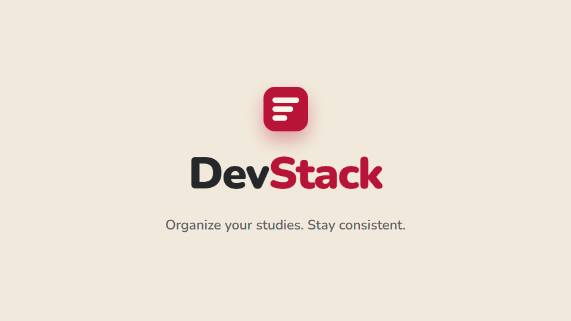
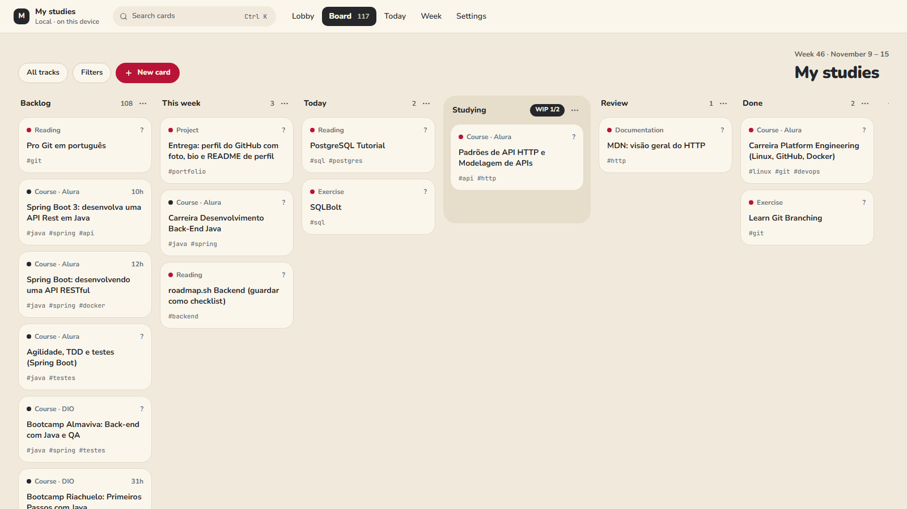
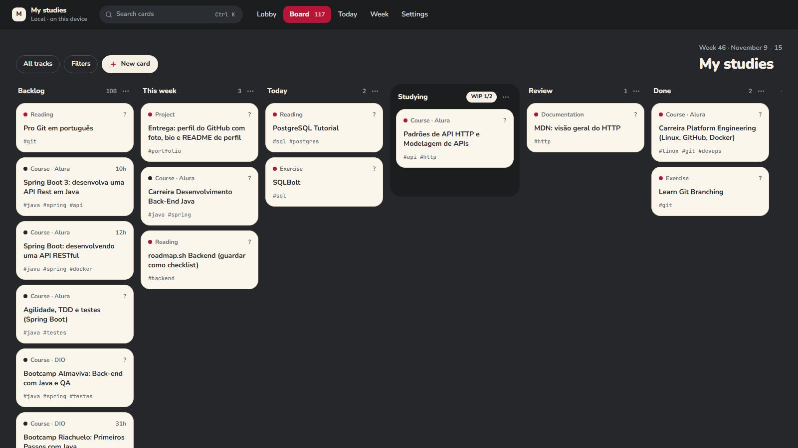
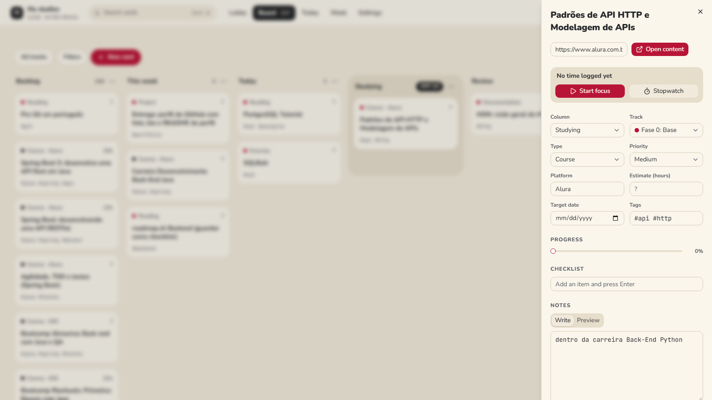
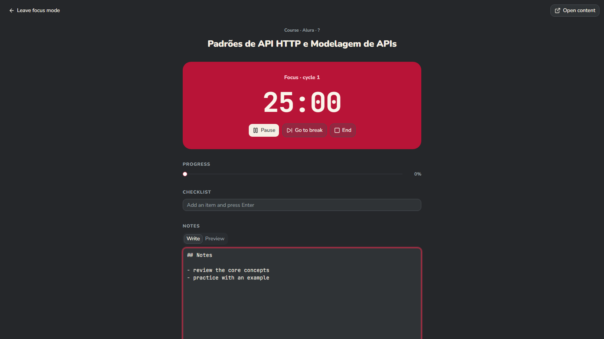
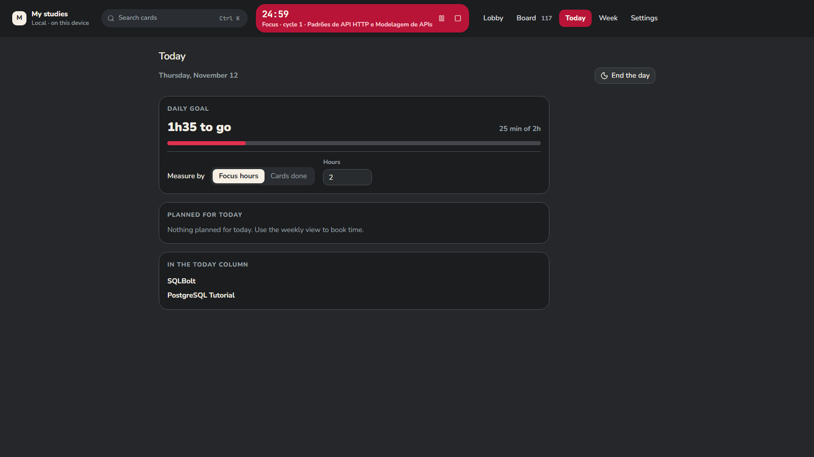
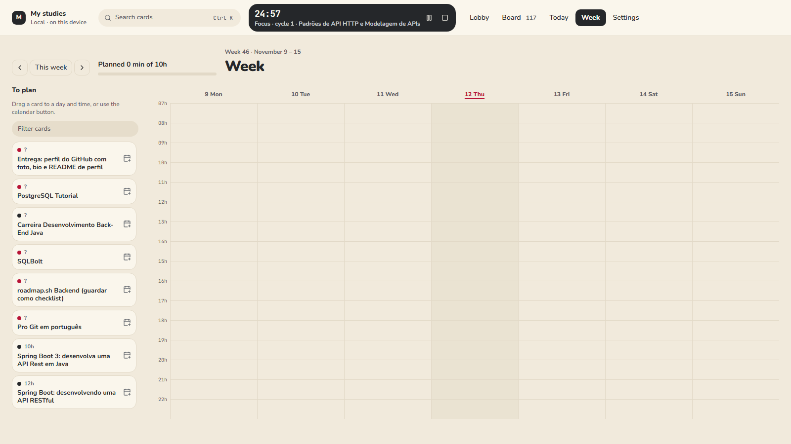
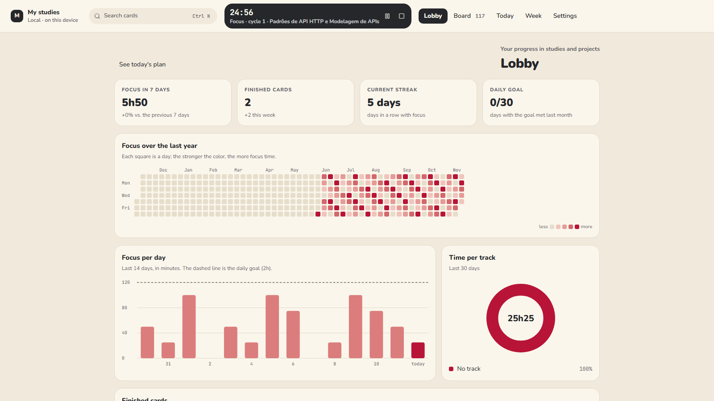
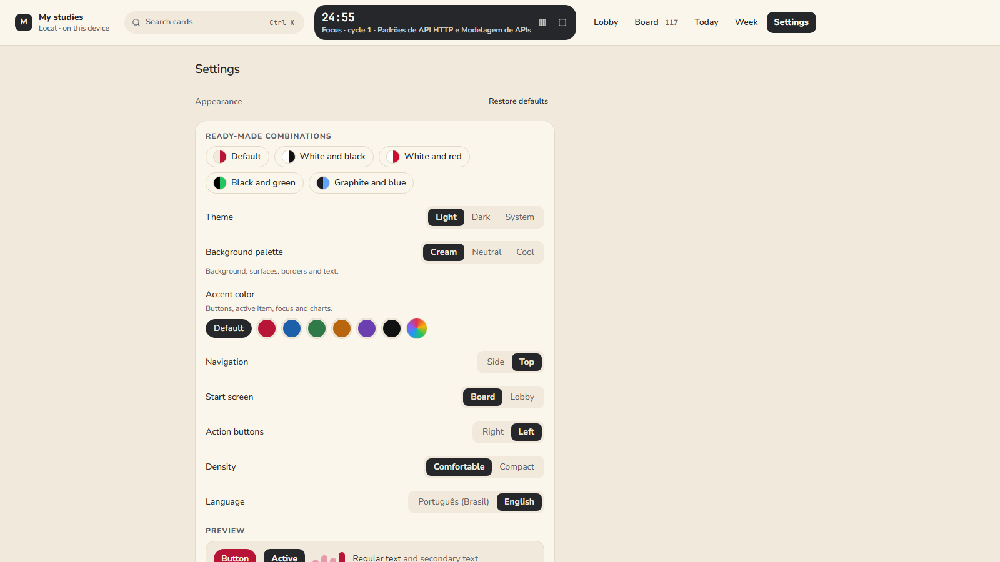

<div align="center">

# DevStack

**A study Kanban for developers: paste a link, drag the card, focus, grow.**

**English** · [Português](README.pt-BR.md)

[](https://github.com/LucasTrombiniBatista/devstack/releases/latest)
[](https://github.com/LucasTrombiniBatista/devstack/actions/workflows/ci.yml)
[](LICENSE)


</div>

## Why DevStack exists

Developers study all the time: courses, docs, books, videos, exercises. The problem is that all of it gets scattered. Courses get saved and forgotten, tabs pile up, and studying never becomes a routine.

I built DevStack to organize my own studies and tasks as a developer, with three goals:

- **Organize:** every piece of content becomes a card on a Kanban board, from backlog to done.
- **Focus:** a focus timer tied to the card, with a screen that shows only what matters.
- **Stay consistent:** a weekly plan, a daily goal and a dashboard that shows every day you studied.

The project is **open source** and anyone can use it. Your data stays on your device: no account, no server.

## Presentation video

[](https://github.com/LucasTrombiniBatista/devstack/releases/download/v0.1.4/devstack.en.mp4)

<sub>Click the image to watch (MP4, 50 s).</sub>

## Features

### Kanban board

Six columns (Backlog, This week, Today, Studying, Review and Done), with a WIP limit on "Studying". Drag with mouse, touch or keyboard only. Colored tracks, filters and global search.

| Light theme                                                             | Dark theme                                                            |
| ----------------------------------------------------------------------- | --------------------------------------------------------------------- |
|  |  |

### Every study is a card

Link, type, platform, track, tags, priority, estimate, target date, progress, checklist and Markdown notes. Paste a link and the card is created for you; on desktop the title is fetched from any page.



### Focus mode

Configurable Pomodoro or a free stopwatch, started from the card itself. Each session is logged and added to the card's time. The timer survives page reloads, and on desktop it keeps running in the system tray.



### Today and Week

See what to study right now and spread your cards across the week, with the daily goal in sight.

| Today                                                        | Week                                                           |
| ------------------------------------------------------------ | -------------------------------------------------------------- |
|  |  |

### Lobby: consistency you can see

Focus hours, completed cards, day streak, goals met, a yearly heatmap (GitHub style), focus per day and time per track.



### And also

- **Import your backlog from Markdown:** a list of links becomes cards, and headings become tracks. [`DevStack.md`](DevStack.md) is a real example.
- **Command palette** with `Ctrl/Cmd + K`: create a card, paste a link, search and navigate.
- **Customizable appearance:** background and accent palettes, with contrast adjusted automatically to WCAG AA.
- **Backup:** export and import as JSON, Markdown or CSV.
- **Local-first and offline:** data lives in IndexedDB, and the site works without internet after the first visit (PWA).
- **Automatic updates** in the desktop app.
- **Portuguese and English.**



## Installation

### Windows (desktop app)

1. Download the installer from the [latest release](https://github.com/LucasTrombiniBatista/devstack/releases/latest): `DevStack_x.y.z_x64-setup.exe` or the `.msi` (`en-US` or `pt-BR`).
2. Run the installer. It is not code-signed yet, so Windows may show a SmartScreen warning: click **More info → Run anyway**.
3. Done. When a new version comes out, the app tells you and updates itself.

> If Windows **Smart App Control** is on, it blocks unsigned installers. In that case, run the web version from source (below).

### Run from source (web)

Requires [Node 24+](https://nodejs.org) and [pnpm](https://pnpm.io).

```bash
git clone https://github.com/LucasTrombiniBatista/devstack.git
cd devstack
pnpm install
pnpm dev
```

Open the address shown in the terminal (usually `http://localhost:5173`). To start with a ready-made backlog, go to **Settings → Import list** and pick `DevStack.md`.

### Build the desktop app (Tauri)

Also requires Rust (toolchain `stable-x86_64-pc-windows-msvc`), Visual Studio Build Tools with C++ and WebView2.

```bash
pnpm tauri dev     # desktop app in development mode
pnpm tauri build   # builds the installer into src-tauri/target/release/bundle
```

When Smart App Control is on, it also blocks the programs Rust compiles during the build. That is why the desktop app is built on GitHub Actions: the CI `desktop` job checks the Rust code, and the `Release` workflow builds the installer for every `vX.Y.Z` tag.

## How the project was built

DevStack started with a spec written before any code: [`DevStack.md`](DevStack.md) (in Portuguese). Part A defines the product, and Part B is my own study backlog, which became the app's first dataset (and the fixture for the importer tests). Development went in short phases, each one ending with the app running and the tests passing:

| Phase                  | What shipped                                                                                                 |
| ---------------------- | ------------------------------------------------------------------------------------------------------------ |
| 0. Foundation          | Vite, React and TypeScript, Tailwind and shadcn/ui, lint, tests and CI from the first commit                 |
| 1. Local data          | IndexedDB schema with Dexie, typed repositories and sync-ready fields (UUID, version, soft delete)           |
| 2. Kanban              | Columns with WIP, accessible drag and drop (dnd-kit), card details, tracks, filters and the "Carmine" theme  |
| 3. Capture and import  | Paste a link to create a card, `Ctrl+K` palette, Markdown parser tested against `DevStack.md` itself, backup |
| 4. Focus timer         | Pomodoro and stopwatch based on timestamps, surviving page reloads                                           |
| 5. Week and goal       | Weekly plan, Today screen and daily goal                                                                     |
| 6. Desktop and release | Tauri 2 with tray and notifications, offline PWA, installer built in CI, accessibility and performance pass  |
| 8. Appearance          | Background and accent palettes with automatic contrast                                                       |
| 9. Lobby               | Stats and charts in hand-made SVG, no new library                                                            |
| 10. Updates            | Signed Tauri updater, published with every release                                                           |

A few decisions that guided the way:

- **Local-first:** no backend and no account. Everything stays on the device, but every record is already shaped for future sync.
- **Fractional indexing for order:** moving a card writes a single record.
- **Same front end on web and desktop:** `HashRouter` and relative paths let the same build run in the browser and inside Tauri.
- **Quality from day one:** unit tests with Vitest, end-to-end flows with Playwright and accessibility checks (axe, WCAG AA) on every screen and color combination.

Details for each phase are in [`docs/ROADMAP.md`](docs/ROADMAP.md), and the version history in [`CHANGELOG.md`](CHANGELOG.md) (both in Portuguese).

## Stack

React, TypeScript, Vite, Tailwind, shadcn/ui, Zustand, React Router and i18next. Local data in IndexedDB with Dexie. Drag and drop with dnd-kit. Desktop with Tauri 2. Tests with Vitest, Testing Library, Playwright and axe.

## Scripts

| Command          | What it does                                |
| ---------------- | ------------------------------------------- |
| `pnpm dev`       | Development server                          |
| `pnpm build`     | Typecheck and production build into `dist/` |
| `pnpm typecheck` | Typecheck only                              |
| `pnpm lint`      | oxlint                                      |
| `pnpm format`    | Prettier (use `format:check` to only check) |
| `pnpm test`      | Unit tests (Vitest)                         |
| `pnpm e2e`       | End-to-end tests (Playwright)               |
| `pnpm tauri`     | Tauri CLI (`dev`, `build`, `icon`)          |

The first time, Playwright needs a browser: `pnpm exec playwright install chromium`.

## Releases

Changes for each version are in [`CHANGELOG.md`](CHANGELOG.md). To release a version: update `version` in `package.json` and the changelog, then push the tag (`git tag vX.Y.Z && git push origin vX.Y.Z`).

## Contributing

Issues and pull requests are welcome. Before opening a PR, run `pnpm lint`, `pnpm format:check`, `pnpm typecheck`, `pnpm test` and `pnpm e2e`. Commits follow [Conventional Commits](https://www.conventionalcommits.org/).

## License

[MIT](LICENSE)
