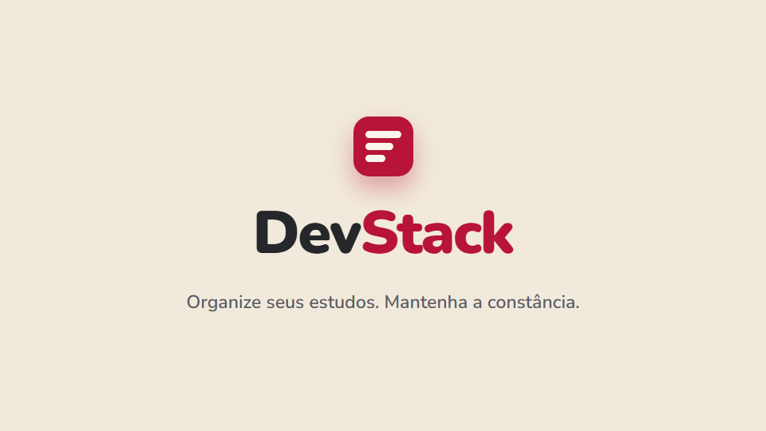
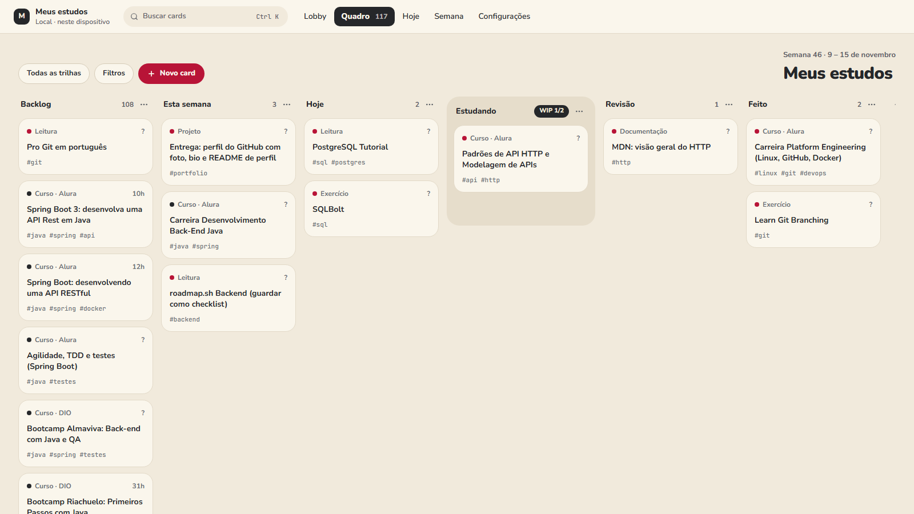
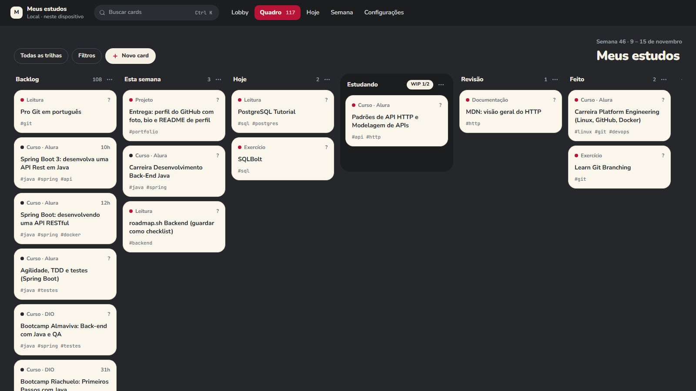
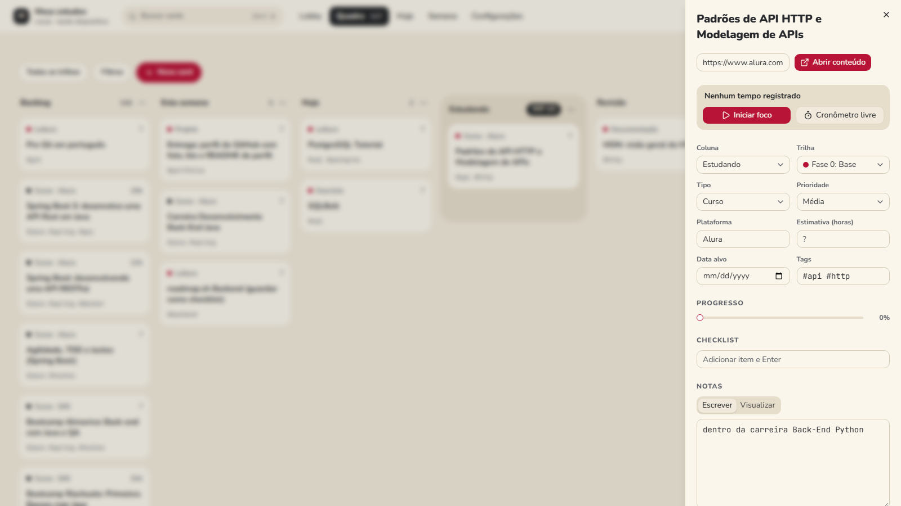
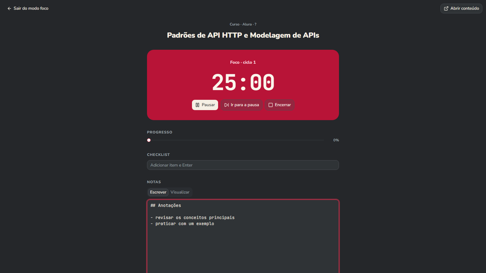
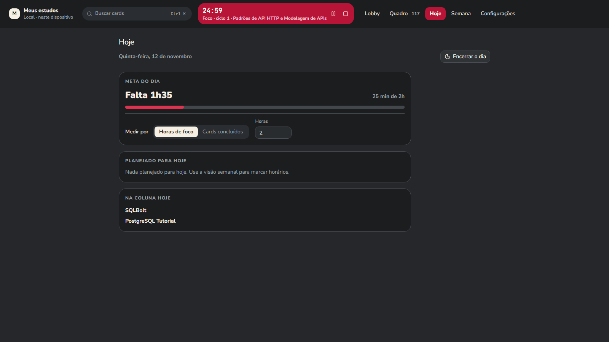
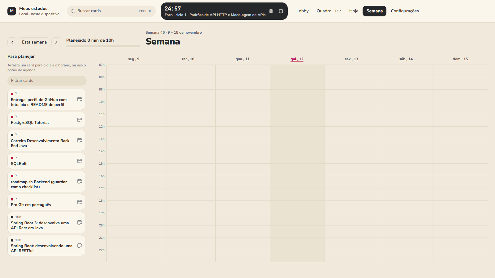
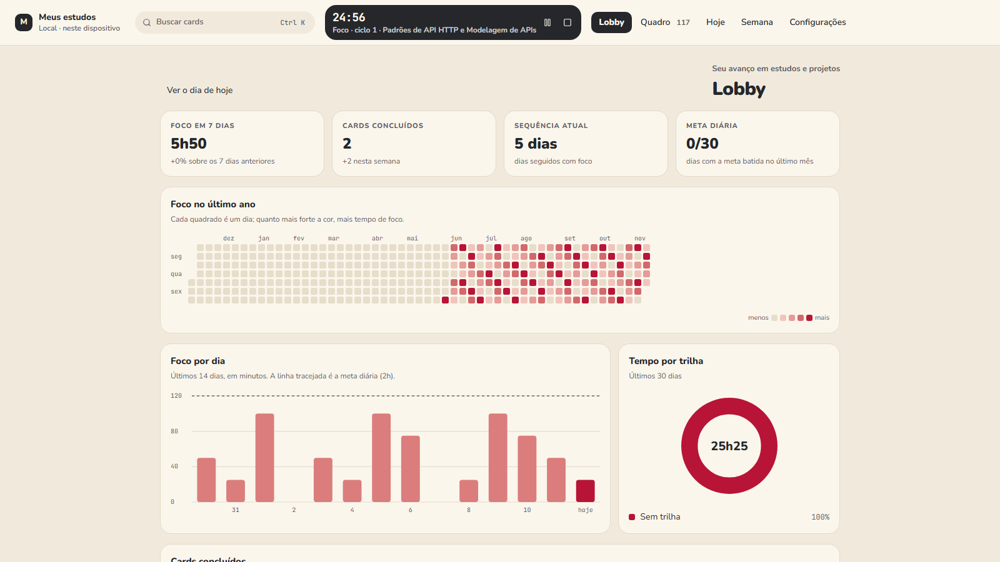
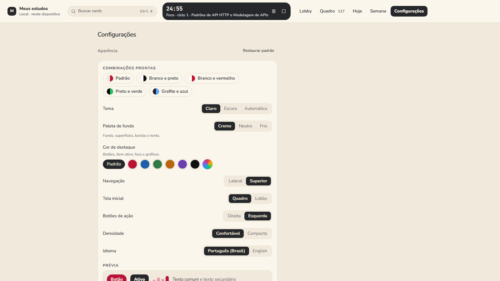

<div align="center">

# DevStack

**Kanban de estudos para quem programa: cole um link, arraste o card, foque, evolua.**

[English](README.md) · **Português**

[](https://github.com/LucasTrombiniBatista/devstack/releases/latest)
[](https://github.com/LucasTrombiniBatista/devstack/actions/workflows/ci.yml)
[](LICENSE)


</div>

## Por que o DevStack existe

Quem programa estuda o tempo todo: cursos, documentação, livros, vídeos, exercícios. O problema é que tudo isso se espalha. Cursos ficam salvos e esquecidos, as abas se acumulam e o estudo não vira rotina.

Criei o DevStack para organizar os meus próprios estudos e tarefas como desenvolvedor, com três objetivos:

- **Organizar:** cada conteúdo vira um card num Kanban, do backlog ao feito.
- **Focar:** um timer de foco ligado ao card, com uma tela que mostra só o que importa.
- **Manter a constância:** plano semanal, meta diária e um painel que mostra cada dia de estudo.

O projeto é **open source** e qualquer pessoa pode usar. Seus dados ficam no seu dispositivo: não há conta nem servidor.

## Vídeo de apresentação

[](https://github.com/LucasTrombiniBatista/devstack/releases/download/v0.1.4/devstack.pt-BR.mp4)

<sub>Clique na imagem para assistir (MP4, 50 s).</sub>

## Funcionalidades

### Quadro Kanban

Seis colunas (Backlog, Esta semana, Hoje, Estudando, Revisão e Feito), com limite de WIP em "Estudando". Arraste com mouse, toque ou só pelo teclado. Trilhas coloridas, filtros e busca global.

| Tema claro                                                                 | Tema escuro                                                                |
| -------------------------------------------------------------------------- | -------------------------------------------------------------------------- |
|  |  |

### Cada estudo é um card

Link, tipo, plataforma, trilha, tags, prioridade, estimativa, data alvo, progresso, checklist e notas em Markdown. Cole um link e o card nasce sozinho; no desktop o título vem de qualquer página.



### Modo foco

Pomodoro configurável ou cronômetro livre, iniciado pelo próprio card. A sessão é gravada e soma no tempo do card. O timer sobrevive a recarregar a página, e no desktop continua na bandeja.



### Hoje e Semana

Veja o que estudar agora e distribua os cards pela semana, com a meta diária à vista.

| Hoje                                                         | Semana                                                            |
| ------------------------------------------------------------ | ----------------------------------------------------------------- |
|  |  |

### Lobby: a constância visível

Horas de foco, cards concluídos, sequência de dias, meta batida, mapa de calor do ano (estilo GitHub), foco por dia e tempo por trilha.



### E também

- **Importe seu backlog em Markdown:** uma lista com links vira cards, e títulos viram trilhas. O [`DevStack.md`](DevStack.md) é um exemplo real.
- **Paleta de comandos** com `Ctrl/Cmd + K`: criar card, colar link, buscar e navegar.
- **Aparência personalizável:** paletas de fundo e de destaque, com contraste ajustado sozinho para WCAG AA.
- **Backup:** exporte e importe em JSON, Markdown ou CSV.
- **Local-first e offline:** os dados ficam no IndexedDB, e o site funciona sem internet depois da primeira visita (PWA).
- **Atualização automática** no app desktop.
- **Português e inglês.**



## Instalação

### Windows (app desktop)

1. Baixe o instalador na [última release](https://github.com/LucasTrombiniBatista/devstack/releases/latest): `DevStack_x.y.z_x64-setup.exe` ou o `.msi` (`pt-BR` ou `en-US`).
2. Execute o instalador. Como ele ainda não tem assinatura de código, o Windows pode mostrar o aviso do SmartScreen: clique em **Mais informações → Executar assim mesmo**.
3. Pronto. Quando sair uma versão nova, o próprio app avisa e se atualiza.

> Se o **Controle Inteligente de Aplicativos** do Windows estiver ligado, ele bloqueia instaladores sem assinatura. Nesse caso, rode a versão web a partir do código (abaixo).

### Rodar a partir do código (web)

Requer [Node 24+](https://nodejs.org) e [pnpm](https://pnpm.io).

```bash
git clone https://github.com/LucasTrombiniBatista/devstack.git
cd devstack
pnpm install
pnpm dev
```

Abra o endereço que aparecer no terminal (normalmente `http://localhost:5173`). Para começar com um backlog pronto, vá em **Configurações → Importar lista** e escolha o `DevStack.md`.

### Compilar o app desktop (Tauri)

Requer também Rust (toolchain `stable-x86_64-pc-windows-msvc`), Visual Studio Build Tools com C++ e WebView2.

```bash
pnpm tauri dev     # app desktop em modo de desenvolvimento
pnpm tauri build   # gera o instalador em src-tauri/target/release/bundle
```

O Controle Inteligente de Aplicativos, quando ligado, também bloqueia os programas que o Rust compila durante o build. Por isso o desktop é compilado pelo GitHub Actions: o job `desktop` do CI confere o código Rust, e o workflow `Release` gera o instalador a cada tag `vX.Y.Z`.

## Como o projeto foi feito

O DevStack começou com uma especificação escrita antes do código, o [`DevStack.md`](DevStack.md). A Parte A define o produto, e a Parte B é o meu próprio backlog de estudos, que virou o primeiro conjunto de dados do app (e a fixture dos testes do importador). O desenvolvimento seguiu fases curtas, cada uma terminando com o app rodando e os testes passando:

| Fase                    | O que entrou                                                                                                        |
| ----------------------- | ------------------------------------------------------------------------------------------------------------------- |
| 0. Fundação             | Vite, React e TypeScript, Tailwind e shadcn/ui, lint, testes e CI desde o primeiro commit                           |
| 1. Dados locais         | Schema no IndexedDB com Dexie, repositórios tipados e campos prontos para sincronização (UUID, versão, soft delete) |
| 2. Kanban               | Colunas com WIP, arrastar e soltar acessível (dnd-kit), detalhe do card, trilhas, filtros e o tema "Carmim"         |
| 3. Captura e importação | Colar link vira card, paleta `Ctrl+K`, parser de Markdown testado contra o próprio `DevStack.md`, backup            |
| 4. Timer de foco        | Pomodoro e cronômetro por timestamps, que sobrevivem a recarregar a página                                          |
| 5. Semana e meta        | Plano semanal, tela Hoje e meta diária                                                                              |
| 6. Desktop e publicação | Tauri 2 com bandeja e notificações, PWA offline, instalador gerado no CI, passada de acessibilidade e desempenho    |
| 8. Aparência            | Paletas de fundo e destaque com contraste automático                                                                |
| 9. Lobby                | Estatísticas e gráficos em SVG próprio, sem biblioteca nova                                                         |
| 10. Atualização         | Atualizador assinado do Tauri, publicado a cada release                                                             |

Algumas decisões que guiaram o caminho:

- **Local-first:** sem backend e sem conta. Tudo fica no aparelho, mas cada registro já nasce pronto para uma sincronização futura.
- **Ordem por índice fracionário:** mover um card grava um único registro.
- **Mesmo front na web e no desktop:** `HashRouter` e caminhos relativos fazem o mesmo build servir no navegador e dentro do Tauri.
- **Qualidade desde o início:** testes unitários com Vitest, fluxos de ponta a ponta com Playwright e verificações de acessibilidade (axe, WCAG AA) em todas as telas e combinações de cores.

Os detalhes de cada fase estão em [`docs/ROADMAP.md`](docs/ROADMAP.md), e o histórico de versões no [`CHANGELOG.md`](CHANGELOG.md).

## Stack

React, TypeScript, Vite, Tailwind, shadcn/ui, Zustand, React Router e i18next. Dados locais em IndexedDB com Dexie. Arrastar e soltar com dnd-kit. Desktop com Tauri 2. Testes com Vitest, Testing Library, Playwright e axe.

## Scripts

| Comando          | O que faz                                       |
| ---------------- | ----------------------------------------------- |
| `pnpm dev`       | Servidor de desenvolvimento                     |
| `pnpm build`     | Typecheck e build de produção em `dist/`        |
| `pnpm typecheck` | Só o typecheck                                  |
| `pnpm lint`      | oxlint                                          |
| `pnpm format`    | Prettier (use `format:check` para só verificar) |
| `pnpm test`      | Testes unitários (Vitest)                       |
| `pnpm e2e`       | Testes de ponta a ponta (Playwright)            |
| `pnpm tauri`     | CLI do Tauri (`dev`, `build`, `icon`)           |

Na primeira vez, o Playwright precisa do navegador: `pnpm exec playwright install chromium`.

## Versões

As mudanças de cada versão ficam no [`CHANGELOG.md`](CHANGELOG.md). Para lançar uma versão: atualizar `version` no `package.json` e o changelog, e enviar a tag (`git tag vX.Y.Z && git push origin vX.Y.Z`).

## Contribuir

Issues e pull requests são bem-vindos. Antes de abrir um PR, rode `pnpm lint`, `pnpm format:check`, `pnpm typecheck`, `pnpm test` e `pnpm e2e`. Os commits seguem o [Conventional Commits](https://www.conventionalcommits.org/pt-br/).

## Licença

[MIT](LICENSE)
